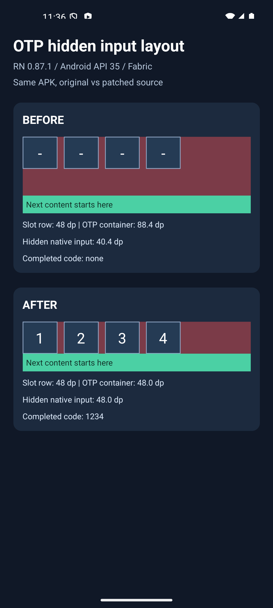

# Hidden OTP input: native layout regression

Related issue: https://github.com/yjose/input-otp-native/issues/15

Original `89cf179` and patched `5af66bd` source copies run in the same RN **0.87.1 / React 19.2.3 / Hermes / Fabric** app. The recorded device is a **Pixel 7 API 35 Android emulator**. This is a Debug APK with developer support disabled and an embedded `--dev false` JS bundle. Library source is unchanged for observation; the app uses public props (`render`, `onLayout`, `onComplete`) and a wrapper's `onLayout`.

| Native measurement | Original | Patched |
|---|---:|---:|
| Visible slot row | 48 dp | 48 dp |
| OTP wrapper height | 88.4 dp | 48 dp |
| Hidden TextInput height | 40.4 dp, in normal flow | 48 dp, absolute overlay |

The screenshot also records `1234` entered into the patched field via Android keyboard input and received by `onComplete`. Original field typing was not part of this comparison; its demonstrated regression is layout, not rejected input.



## Reproduce

Clone this fork and check out `evidence/hidden-input-rn87`. Use an existing disposable bare React Native app with dependencies installed:

```sh
python3 evidence/prepare-fixture.py /absolute/path/to/test-app
```

The script creates `otpBefore/`, `otpAfter/` and `OTPLayoutFixture.tsx`. Import the fixture as the application's root. Build/run normally; no extra native dependencies are needed. Tap the patched slots, enter `1234`, then dismiss the keyboard. The displayed dimensions come from native layout callbacks.

The upstream change contains only one source-line replacement plus two component regressions. These extra files remain on this fork branch.

Native iOS and SMS autofill were not tested. Component tests check the iOS low-opacity/caret configuration, completed input and caller style precedence. The upstream web example was exported and opened locally with no captured console errors.
